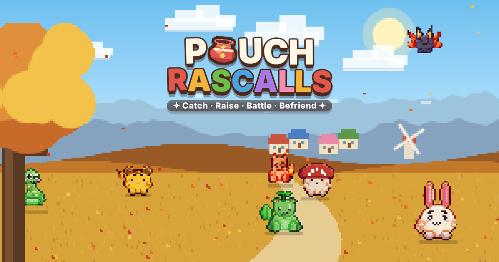

# Pouch Rascalls

A cozy-fantasy monster-taming RPG that runs entirely in your browser — catch, raise, breed and battle **rascals**, build your ranch and home, earn badges, and meet some legends along the way.

**▶ Play:** https://m0998001.github.io/pouch-rascalls/

- Works on phone, tablet and desktop (touch controls or keyboard: arrows/WASD, Z to confirm, X for menu)
- Saves in your browser; use *Save Code* in the menu to move a save between devices
- Most art, music, and the 2.5D view are generated in code; the six starter creatures now also have hand-designed front-facing PNG sprites in `assets/starter-sprites/`

### On iPhone or iPad
Open the link in Safari, tap **Share → Add to Home Screen**. It then launches full-screen like an app, works offline, and Safari won't clear your saves.
